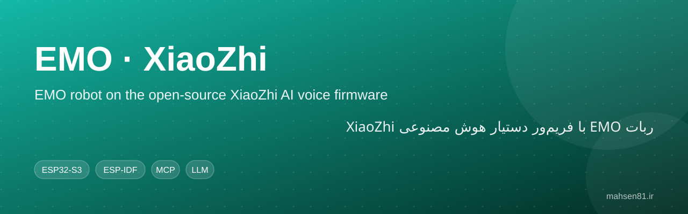

<!-- gen:header -->
<p align="center"></p>

<h1 align="center">EMO · XiaoZhi</h1>
<p align="center"><b>ربات EMO با فریم‌ور دستیار هوش مصنوعی XiaoZhi</b><br><i>EMO robot on the open-source XiaoZhi AI voice firmware</i></p>
<p align="center">   </p>

<div dir="rtl">

## ✨ امکانات

- گفتگوی صوتی با مدل‌های زبانی
- کنترل دستگاه با پروتکل MCP
- چشم‌های متحرک سفارشی

</div>

## 🚀 Quick start

```bash
cd xiaozhi-esp32 && idf.py build flash monitor
```

---

<p align="center">ساخته‌شده توسط <a href="https://mahsen81.ir"><b>محسن جباره‌اصل</b></a> — برنامه‌نویسی، طراحی سایت، ربات و هوش مصنوعی<br>
Built by <a href="https://mahsen81.ir">Mohsen Jabbareh-Asl</a> · ⭐ اگر مفید بود، ستاره بدهید · Need a custom version? <a href="https://mahsen81.ir">Get in touch</a></p>
